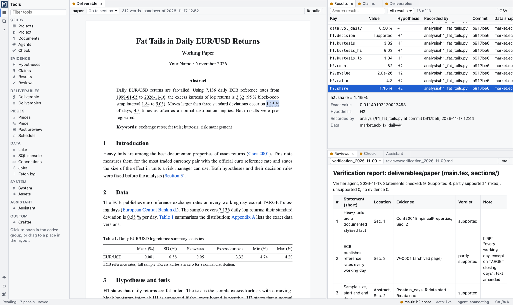
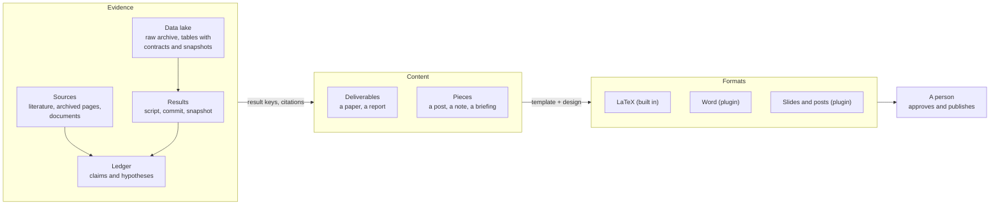
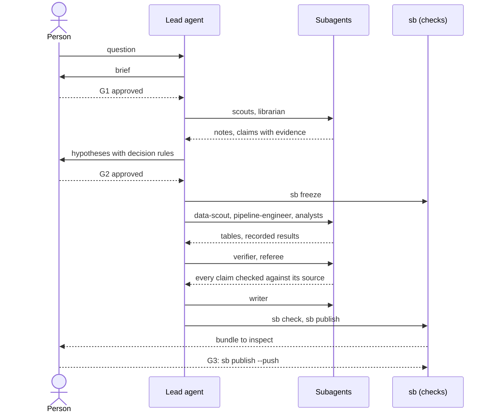
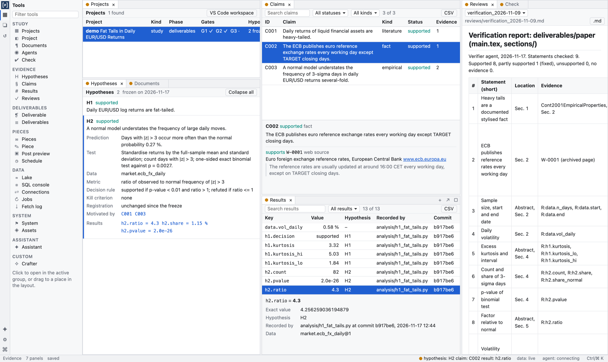
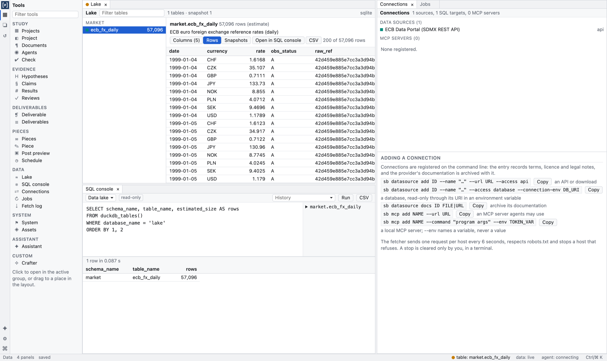
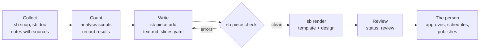
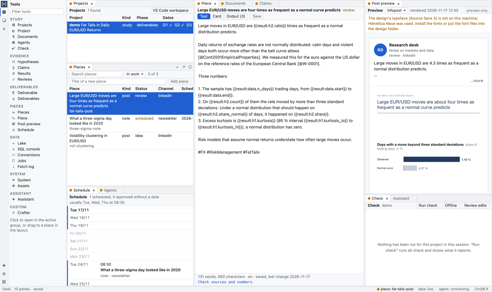
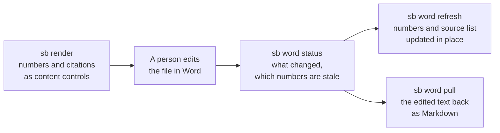

<p align="center"></p>

<p align="center">A workflow for AI coding agents and the people who direct them, for research and for the content made from it.<br>
Every statement points to a citation, an archived source, a recorded result or a versioned dataset, and a check fails when one does not.</p>

<p align="center">
<a href="https://github.com/julian-hilg/sourcebound">github.com/julian-hilg/sourcebound</a> ·
<a href="INSTALL.md">Install</a> ·
<a href="AGENTS.md">Rules for agents</a> ·
<a href="docs/desks-and-formats.md">Desks and formats</a> ·
<a href="DEVELOPMENT.md">Development</a>
</p>

<p align="center">
<a href="LICENSE"></a>
</p>

<p align="center"></p>

## Features

- **No source, no claim.** Agents write into a ledger: every statement names its evidence (a citation, an archived web page or document, a recorded result, a dataset version). `sb check` fails on a reference that does not resolve and lists numbers typed by hand.
- **Hypotheses before data.** A study's hypotheses are frozen with a hash before analysis; a later change is reported and needs a written amendment.
- **Numbers that know where they came from.** Every number is recorded by a committed script with its commit and the data snapshot it read, and enters a text as `{{result:key}}`, never by hand.
- **Studies and desks.** A study answers one question and ends in a paper. A desk follows a topic and produces posts, notes, briefings and reports along the way, under the same rule, without a paper first.
- **One evidence base, many formats.** LaTeX is built in. Word documents and slides are optional plugins that render from registered templates in an organisation's own design. A Word file edited by hand keeps its link to the research.
- **A data lake that agents cannot spoil.** Raw responses are archived unchanged, tables have contracts and snapshots, and the fetcher keeps its manners: one request per host every six seconds, robots.txt, and a full stop at the first refusal.
- **People hold the gates.** Approving a brief, freezing hypotheses, clearing a stopped host, approving and publishing anything: these need a person at a terminal. Nothing posts by itself.
- **A web view, if you want one.** A local frontend shows every project, the lake, connections, jobs and what agents are doing, and an agent can read and drive it too.

## How it fits together



Three rules shape everything:

1. **Evidence is shared, never copied.** A post and a paper cite the same archived source and use the same recorded number.
2. **Content is written once,** in Markdown or LaTeX with references to evidence. A format is a way to render it; none is privileged.
3. **Rules live in tools, not in prompts.** What an agent must not do (invent a citation, change a frozen hypothesis, retry a refused host, publish) is checked or refused by the `sb` command.

## Quick start

```sh
git clone https://github.com/julian-hilg/sourcebound.git
cd sourcebound
make install                     # on Windows: uv sync; uv run sb install
sb doctor
```

The installation asks for two folders: the **data root** holds the lake, the raw archive and
the registry; the **research folder** holds your projects. See **[INSTALL.md](INSTALL.md)** for requirements, Windows, the optional
parts, and prompts you can give a coding agent to do all of this for you.

```sh
sb new demo --title "Fat Tails Demo"            # a complete worked study, in your research folder
sb new my_desk --title "..." --kind desk        # ongoing research on a topic
```

Open Claude Code in a project and say *use the research-study skill* or *use the
content-desk skill*.

## A study

```
brief (G1) -> landscape -> hypotheses (G2: frozen) -> data -> analysis -> review -> deliverables -> publish (G3)
   lead        scouts        lead + referee          data-scout    analysts    verifier     writer          sb publish
               librarian                             pipeline-eng.             referee
```

The main session is the lead; eight subagents do the legwork and hand over files.



<p align="center">

&nbsp;

</p>

## A desk

```sh
sb doc report.pdf --title "..." --publisher "..."      # a local report becomes a citable source (W-0001)
sb snap https://example.org/page --title "..."         # so does a web page, archived
sb piece add "Large moves are more frequent than expected" --kind post --template text
sb piece check                                         # sources registered, numbers recorded
sb render <piece> --template <template>                # text, Markdown, Word, slides
sb piece set <piece> --status approved                 # your decision, at a terminal
```

A piece is a folder with its text, the structured content a template needs and what was
rendered. `sb piece check` fails on a cited source that is not registered and on a result
that was not recorded. Approving, scheduling and publishing are the person's; nothing in
Sourcebound posts to a network.



<p align="center">

</p>

## Formats and designs

| Format | Comes with | Renders | Notes |
| --- | --- | --- | --- |
| LaTeX | the core | a deliverable as PDF | optional: without TeX everything else works |
| Handover | the core | a format-neutral folder: Markdown, results, tables as CSV, figures, bibliography | what other tools render from |
| Markdown, plain text | the core | a piece or a deliverable with numbers filled in and sources listed | `sb render <target> --template text` |
| Word | [`plugins/word`](plugins/word/README.md) | `.docx` from a `.docx`, `.dotx` or `.dotm` template | numbers and citations stay linked after editing in Word: `sb word status`, `refresh`, `pull` |
| Slides and posts | [`plugins/linkedin`](plugins/linkedin/README.md) | HTML, one PNG per slide, a carousel PDF, post text | the render fails when text overflows or labels collide |

```sh
uv sync --extra word --extra linkedin
sb plugin list; sb template list; sb design list
```

A **design** is one file of colours, fonts, logo and chart rules that every format reads, so
a report, a slide and a chart of one organisation agree. A **template** belongs to one
format. Both live in the registry of the data root, not in this repository; an organisation
keeps its own in a **pack** (a folder, usually a private repository) and installs it with
`sb pack install FOLDER`. This repository ships one neutral design.

<p align="center">

</p>

When a Word file was edited by hand:



## Data

- **Raw is immutable.** Every response is archived unchanged, compressed and addressed by its SHA-256. Tables can be rebuilt from the archive.
- **Contracts first.** A shared table has a YAML contract (columns, units, primary key, licence, sources) before the first write. A licence that starts with `restricted` keeps a table out of every publication bundle.
- **Snapshots.** The lake is a [DuckLake](https://ducklake.select): Parquet files with a SQL catalog. A result records the snapshot it read.
- **Jobs.** `sb job` runs a pipeline on a schedule, so a source without an API becomes a table that stays current. The fetcher's rules hold unchanged.
- **Connections.** `sb sql lake|SOURCE "SELECT ..."` runs one read-only statement; `sb mcp` registers MCP servers and links them into a project; private sources keep their token in an environment variable.

Details: [docs/data-access.md](docs/data-access.md), [docs/jobs-and-connections.md](docs/jobs-and-connections.md).

## The web view

```sh
sb ui --build        # once; needs Node.js 22 or newer
sb ui                # http://127.0.0.1:5210
```

Optional, and without data of its own: every panel shows what is in the project files and
the data root. It is built on [Werkbank](https://github.com/julian-hilg/werkbank), so every
action is a command and every panel can return its data: a coding agent connected over MCP
reads and drives it like a person does, and anything that writes waits for approval.

| Workspace | Panels |
| --- | --- |
| Study | projects, project card with phases and gates, the deliverable reader, hypotheses, claims, results, agent activity, checks |
| Evidence | hypotheses, claims ledger, results, reviews, documents |
| Reading | a deliverable rendered from the handover without LaTeX; a click on a number selects the result behind it |
| Desk | pieces, the piece editor, post preview, schedule |
| Data | lake explorer, read-only SQL console, connections, jobs, fetch log |
| System | what is installed and configured, designs, templates and plugins |

Details: [docs/frontend.md](docs/frontend.md).

## What is in here

| Path | What it is |
| --- | --- |
| `AGENTS.md` | the rules every agent follows: phases and gates, "no source, no claim", data and scraping etiquette, publishing |
| `.claude/agents/` | eight subagents: `scout`, `librarian`, `data-scout`, `pipeline-engineer`, `analyst`, `verifier`, `referee`, `writer` |
| `skills/` | the lead's playbooks: `research-study` and `content-desk` |
| `src/sourcebound/` | the Python package and the `sb` command |
| `plugins/word`, `plugins/linkedin` | the optional formats, each a package of its own |
| `frontend/` | the optional web view |
| `templates/project/` | a complete worked study (fat tails of EUR/USD) that `sb new` copies |
| `templates/markdown`, `templates/text`, `designs/sourcebound` | the formats that need no plugin, and the neutral design |
| `contracts/`, `datasources/`, `pipelines/ecb_fx/` | an example contract, source entry and reference pipeline (ECB exchange rates) |
| `latex/` | `sbpaper.cls`, `sbresults.sty` (`\result{key}`), `sbtikz.sty` |
| `docs/` | desks and formats, jobs and connections, data access, the web view |

### The `sb` command

| For | Commands |
| --- | --- |
| Setting up | `sb init`, `sb install`, `sb doctor`, `sb which` |
| A project | `sb new`, `sb status`, `sb check`, `sb run`, `sb freeze` |
| Evidence | `sb snap`, `sb doc`, `sb source`, `sb bib`, `sb papers` |
| Data | `sb lake`, `sb sql`, `sb datasource`, `sb ingest`, `sb job`, `sb mcp`, `sb lineage` |
| Deliverables | `sb sync`, `sb build`, `sb handover`, `sb review-edits`, `sb flatten`, `sb note` |
| Pieces and formats | `sb piece`, `sb render`, `sb design`, `sb template`, `sb pack`, `sb plugin` |
| Publishing | `sb publish` (builds a checked bundle; pushing needs a person) |
| The web view | `sb ui`, `sb workspace` |

`sb --help` lists the commands.

## Verifying

```sh
make test                                   # the core: unit tests and offline pipeline tests
uv sync --extra word --extra linkedin && uv run pytest -q      # with the format plugins
cd frontend && npm install && npm run typecheck && npm run build
```

## Credits

The data lake is [DuckLake](https://ducklake.select) on [DuckDB](https://duckdb.org); tables
are read and written with [Polars](https://pola.rs). The web view is built on
[Werkbank](https://github.com/julian-hilg/werkbank) and renders mathematics with
[KaTeX](https://katex.org). Word documents are written with
[python-docx](https://python-docx.readthedocs.io). The example data are the euro foreign
exchange reference rates of the European Central Bank.

## Licence

Sourcebound is released under the [MIT licence](LICENSE).
Source, issues and releases: [github.com/julian-hilg/sourcebound](https://github.com/julian-hilg/sourcebound).
